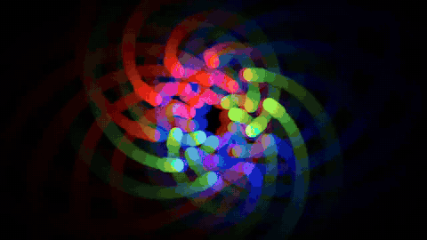
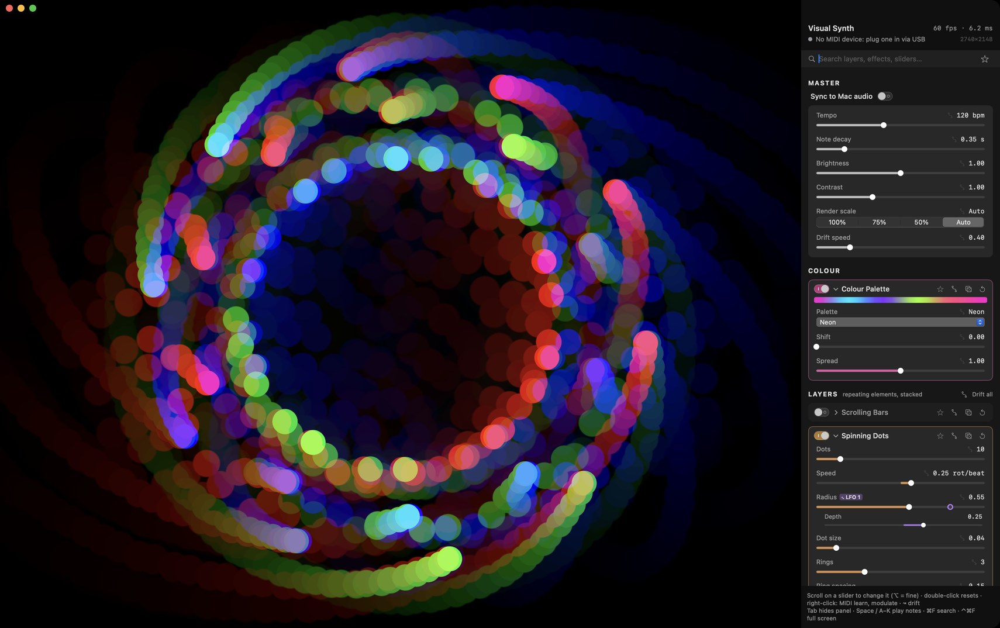

# Visual Synth

Generative visuals for music, native on macOS (Swift + Metal), driven by USB MIDI and by whatever plays on your Mac.

▶ [Full-quality showreel (MP4, 1280×720, 60 fps)](docs/media/showreel.mp4)

It works like a synthesizer for pictures. **Layers** are the oscillators: repeating elements such as bars, orbiting dots or tunnels. **Effects** are the FX chain, visual counterparts of echo, chorus, filter, reverb, bitcrusher and so on. **Modulators** (LFOs, envelope, audio) move any slider in time with the music. Everything renders on the GPU at full Retina resolution.

## What's in it

**Layers** (stacked with Add / Screen / Max / Multiply): Scrolling Bars, Spinning Dots, Polygons, Dot Grid, Tunnel Rings,
Scope Waves, Sunburst, Checker / Moiré, Starfield, Lissajous, Noise Field.

**Image layers**: *Camera* shows the Mac's camera, a USB webcam or an iPhone (Continuity Camera), picked in its card. It
runs only while the layer is on, at the camera's highest frame rate up to 1080p (locked, so dim light doesn't drop it to
15 fps). *Image / Video* shows a still or a looping, muted video: use Open… or drop a file on the picture (the path is
saved with scenes). Both can fill / fit / stretch, mirror, zoom, move, rotate and spin with the beat, and tile or mirror
around the picture. They draw in original colours, mono, tinted with the layer's hue, or through the palette. *Show*
keeps only the bright or dark parts, or traces outlines, so layers below show through. Then run them through the effects
like any other layer.

**Effects** (a reorderable chain, each with a dry/wet Mix): Echo (feedback), Chroma Split (chorus), Transform,
Kaleidoscope, Ripple (phaser), Glitch, Bitcrusher, Ring Mod, Drive, Filter (LP / HP / BP), Hue Shift, Tremolo / Strobe,
Glow (reverb), Polar Warp, Multi-tap Delay, Sidechain Duck, Freeze, Neon Edges, Smear, Melt / Datamosh, CRT, Halftone,
Solarize, Lens, Palette Map.

**Modulators**: 4 beat-synced LFOs (sine, triangle, saws, square, sample & hold, smooth random), an ADSR envelope played by
notes, and a note-random source. Sliders can also follow audio bass / mid / high / loudness, note pitch, velocity or the
mod wheel. Right-click any slider → *Modulate by…* and set the depth; a ring on the slider shows where it is being pushed.
The **+ / ±** button next to the depth picks the direction: **+** pushes the slider up from where you set it (down with a
negative depth), **±** swings it both ways around that value.

**Colour palette**: when it's switched on, every layer takes its colours from one palette (Neon, Sunset, Ocean, Fire, Ice,
Acid, Pastel, Vapor, Mono or your own colours). *Shift* rotates them all, and makes a good target for drift or an LFO.

**Timing**: notes from any USB MIDI device (hot-plug) trigger pulses and envelopes, and MIDI clock sets the tempo. Without
a clock, *Sync to Mac audio* follows the beat of whatever is playing (Spotify, YouTube, …).

**Scenes**: *+ Save* (⌘S) stores the whole look as a scene with a thumbnail. Click a scene, press 1–9, or send MIDI
program change 0–8 to switch, crossfading over Master › Scene fade. Sliders glide to their new values, and layers and
effects fade in or out. Right-click a scene to rename, update, export or delete it. *Import…* (⌘O) adds scene files: each
scene is a single `.json`, easy to share.

**Drift**: ↝ on a slider, a card or a whole section makes it wander on a smooth random walk.

**Panel**: scroll on a slider to change it (⌥ for fine), double-click to reset, right-click for MIDI learn and modulation.
⌘F fuzzy-searches layers, effects and slider names. ☆ stars a card: favourites are grouped at the top, and the ★ filter
shows only them.
Switching a card off folds it away.

Keys: Tab hides the panel · Space and A S D F G H J K play notes (no MIDI device needed) · ⌃⌘F full screen ·
1–9 recall scenes · ⌘S save scene · ⌘O import scenes · Esc cancels MIDI learn.

## Install / run

Requires macOS 14+ and Xcode (or the command line tools) for `swift`.

    scripts/make-app.sh --install   # builds VisualSynth.app and copies it to /Applications
    swift run -c release            # dev: shaders reload live when you edit Sources/VisualSynth/Shaders/*.metal

*Sync to Mac audio* (macOS 14.2+) listens through a Core Audio system-audio tap. The first time, macOS asks to allow
"System Audio Recording Only" (System Settings › Privacy & Security › Screen & System Audio Recording). If the beat lands
early or late on your speakers, set `VISUALSYNTH_AUDIO_OFFSET_MS` (positive = later).

The *Camera* layer asks for camera access the first time it's switched on. `VisualSynth --cameras` lists the cameras and
the permission; `--cameras --test` runs one through the layer for 3 s and prints its frame rate, latency and brightness (no
picture is kept).
Started by another app (a terminal, or a launcher like Raycast), macOS checks camera access against that app, and
the built-in camera then sends only black frames, light on or not. So the .app relaunches itself through Launch
Services when it wasn't started by macOS (set `VISUALSYNTH_NO_RELAUNCH=1` to skip that). `swift run` can't, so use the
iPhone camera there, or the .app. For the test: `open -W --stdout out.txt build/VisualSynth.app --args --cameras --test`.

## Performance

Render scale *Auto* (the default) keeps the frame rate at the display's refresh rate. It lowers the internal resolution
only while the GPU can't keep up, and goes back to full sharpness when it can. To see what each layer and effect costs:

    .build/release/VisualSynth --profile --size 2560x1664

UI stalls block the picture too, since it draws on the main thread. `VISUALSYNTH_LAGTEST=1` (with `VISUALSYNTH_HOME` set
to a temporary folder) hides and shows the panel and opens and folds cards, then prints the longest frame after each.

## Development

Add a layer or effect:

1. Add a `ModuleSpec` to `Generators.swift` or `Effects.swift` / `EffectsMore.swift` (params land in the shader as `p[0…15]`).
2. Write `gen_<id>` / `fx_<id>` in the matching file in `Shaders/`, following the conventions at the top of
   `Shaders/Common.metal`. All shader files compile as one source, so prefix your helpers per file.
3. Check it with `swift build && .build/debug/VisualSynth --check`. Look at it with
   `.build/debug/VisualSynth --render out.png --only bars,<id> --notes`. Time it with `--bench --only bars,<id>`.
   For the image layers, add `--media FILE` (an image or a video).

`scripts/make-media.sh` re-renders the showreel above from the scenes in `scripts/scenes.sh` (needs ffmpeg).

## License

[PolyForm Noncommercial 1.0.0](LICENSE.md): you may use, change and share Visual Synth for any noncommercial purpose
(personal projects, study, hobby, VJing for fun, research, education, charities…). Commercial use needs written
permission from the author. Keep the [NOTICE](NOTICE) line with any copy.
